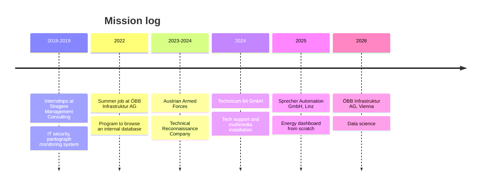

<!-- HEADER -->
<div align="center">


<a href="https://streimi.com">
  
</a>

<br/>

[](https://www.streimi.com)
[](https://www.streimi.com/contact)
[](https://www.streimi.com)


</div>

---

## 👨‍💻 About me

```python
class Dominik:
    def __init__(self):
        self.role     = "HTL graduate · Electronics & Technical Informatics"
        self.based_in = "Austria 🇦🇹"
        self.loves    = ["programming", "graphic design", "multimedia", "games"]
        self.crafts   = ["web apps", "data dashboards", "video edits", "3D renders"]
        self.mission  = "combine technical expertise with artistic expression"

    def currently(self):
        return "building a live global tensions map 🌍"
```

I like where logic meets artistry: shipping clean code one day, grading footage or modeling in Maya the next.

---

## ⚡ Tech Arsenal

<div align="center">

**Web & Programming**


**Design, Video & 3D**


</div>

<details>
<summary><b>📊 Skill levels (click to expand)</b></summary>
<br/>

| Area | Level |
| --- | --- |
| **Web Dev** | `█████████░` 87% |
| **Programming** | `████████░░` 85% |
| **Data Visualization** | `████████░░` 78% |
| **Image & Design** | `████████░░` 79% |
| **Video & Animation** | `███████░░░` 70% |
| **3D Modeling & Animation** | `██████░░░░` 60% |
| **Productivity** | `█████████░` 89% |
| **Tools, IDEs & Platforms** | `████████░░` 84% |

</details>

---

## 🛰️ Flight Path



---

## 🚀 Featured Projects

<table>
  <tr>
    <td width="50%" valign="top">
      <h3>🧟 <a href="https://zombieroom.streimi.com/">Zombieroom Escape Game</a></h3>
      A digital escape room that uses data science and machine learning to stop the apocalypse.
      <br/><br/>
      
      
      
    </td>
    <td width="50%" valign="top">
      <h3>🌍 Live Global Tensions Map</h3>
      Global tensions in real time, based on fetched news reports. <i>Work in progress.</i>
      <br/><br/>
      
      
    </td>
  </tr>
  <tr>
    <td width="50%" valign="top">
      <h3>♠️ <a href="https://www.streimi.com/projects/games/poker">Poker</a> &amp; 🃏 <a href="https://www.streimi.com/projects/games/blackjack">Black Jack</a></h3>
      Two classic card games you can play right in your browser.
      <br/><br/>
      
      
    </td>
    <td width="50%" valign="top">
      <h3>💳 <a href="https://www.streimi.com/projects/creditcard">Animated Credit Card Form</a></h3>
      Form values appear on the card as you type, and it flips on click.
      <br/><br/>
      
      
    </td>
  </tr>
  <tr>
    <td width="50%" valign="top">
      <h3>🔬 L3-Cache DRM</h3>
      Controlled experiments on CPU L3 cache behavior and what it means for DRM security models.
      <br/><br/>
      
      
    </td>
    <td width="50%" valign="top">
      <h3>🏨 Hotel Booking Analysis</h3>
      Analysis of hotel bookings in Portugal with Power BI and Tableau.
      <br/><br/>
      
      
    </td>
  </tr>
  <tr>
    <td colspan="2" align="center">
      <h3>⚛️ <a href="https://github.com/streimi/nextjs-portfolio">Next.js Portfolio</a></h3>
      The site behind all of this, built to learn Next.js and updated frequently.
    </td>
  </tr>
</table>

<div align="center">

[**→ See all projects on streimi.com**](https://www.streimi.com/#projects)

</div>

---

## 🎬 Creative Corner

<div align="center">

Four years of video editing, plus 3D modeling, motion graphics and digital art.

[](https://www.youtube.com/@_streimi_)
[](https://www.deviantart.com/streimi)
[](https://www.artstation.com/streimi)
[](https://www.instagram.com/_streimi_/)

</div>

---

## 📈 GitHub Stats

<div align="center">


</div>

---

## 🐍 Contribution Snake

<div align="center">

<picture>
  <source media="(prefers-color-scheme: dark)" srcset="https://raw.githubusercontent.com/streimi/streimi/output/github-snake-dark.svg" />
  <source media="(prefers-color-scheme: light)" srcset="https://raw.githubusercontent.com/streimi/streimi/output/github-snake.svg" />
  
</picture>

</div>

---

<div align="center">


<sub>// end of transmission</sub>

</div>
